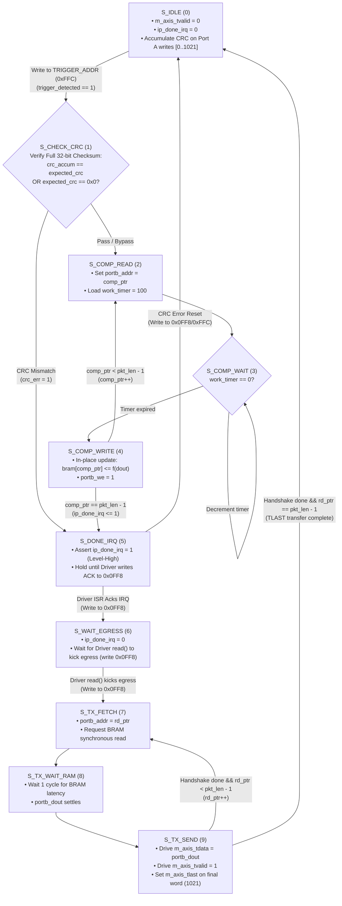
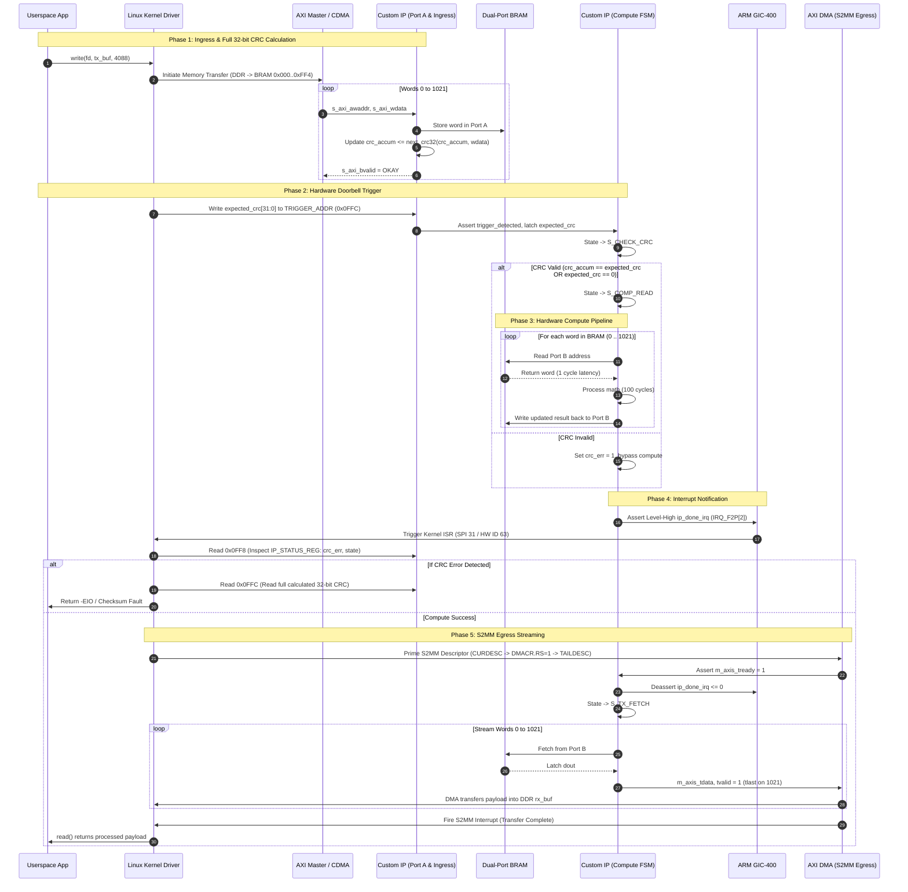

# Store-and-Forward BRAM Accelerator IP: Architecture & Specification

This document provides a comprehensive breakdown of the Custom Hardware Accelerator IP ([`bram_dma_ip.v`](file:///Volumes/SWStorage/Projects/fpga-projects/pynq-z2-ps-pl-loopback/hdl/bram_dma_ip.v)) designed for the PYNQ-Z2 (Zynq-7000 SoC). 

The IP implements a **Store-Compute-Forward** architecture featuring:
* Memory-Mapped AXI4-Lite Ingress directly to internal Block RAM.
* Real-time, zero-overhead On-the-Fly Full 32-bit CRC-32 calculation.
* Hardware Mailbox / Doorbell Trigger detection.
* Decoupled True Dual-Port Block RAM (`RAMB36E1`).
* Dedicated Status Register (`0xFF8`) & Full 32-bit CRC Readback Register (`0xFFC`).
* Level-High Interrupt notification to the ARM GIC (`IRQ_F2P[2]`).
* AXI4-Stream Egress to the Xilinx AXI DMA S2MM engine.

---

## 1. System & Hardware Topology

```
+---------------------------------------------------------------------------------------+
|                               Processing System (PS)                                  |
|                                                                                       |
|   +-------------------+        +--------------------+        +--------------------+   |
|   |   ARM Cortex-A9   |        |   GIC Controller   |        |    DDR Controller  |   |
|   |     (Linux OS)    |        |       (GIC)        |        |    (Physical RAM)  |   |
|   +---------+---------+        +---------+----------+        +---------+----------+   |
|             |                            ^                             ^              |
+-------------|----------------------------|-----------------------------|--------------+
              | M_AXI_GP0                  | IRQ_F2P[2]                  | S_AXI_HP0
              | (Memory-Mapped Bus)        | (Compute Done / Error)      | (S2MM DMA Bus)
+-------------|----------------------------|-----------------------------|--------------+
|             v                            |                             v              |
|   +---------+-----------+                |                 +-----------+----------+   |
|   | AXI Interconnect /  |                |                 |    Xilinx AXI DMA    |   |
|   | Central DMA (CDMA)  |                |                 |    (S2MM Engine)     |   |
|   +---------+-----------+                |                 +-----------^----------+   |
|             |                            |                             | S_AXIS_S2MM  |
|             | S_AXI (0x000 - 0xFFC)      |                             |              |
|             v                            |                             |              |
|   +---------+----------------------------+-----------------------------+----------+   |
|   |                           Custom Accelerator IP                               |   |
|   |                                                                               |   |
|   |   +-----------------------+                         +---------------------+   |   |
|   |   |   AXI Slave Handler   |                         |  AXI-Stream Master  |   |   |
|   |   |  - Address & Data Sync|                         |  - Synchronous Read |   |   |
|   |   |  - Doorbell Detector  |                         |  - TLAST Framing    |   |   |
|   |   |  - Full 32-bit CRC-32 |                         |  - Auto IRQ Deassert|   |   |
|   |   +-----------+-----------+                         +----------^----------+   |   |
|   |               | Port A                                         | Port B       |   |
|   |   +-----------v------------------------------------------------+----------+   |   |
|   |   |                  True Dual-Port Block RAM (4 KB)                      |   |   |
|   |   |                      (Inferred RAMB36E1)                              |   |   |
|   |   +------------------------------------------------------------+----------+   |   |
|   |                                                                | Port B       |   |
|   |                                                     +----------v----------+   |   |
|   |                                                     |   Compute Engine    |   |   |
|   |                                                     | - Multi-Cycle Math  |   |   |
|   |                                                     | - In-Place Updates  |   |   |
|   |                                                     +---------------------+   |   |
|   +-------------------------------------------------------------------------------+   |
|                                                                                       |
|                               Programmable Logic (PL)                                 |
+---------------------------------------------------------------------------------------+
```

---

## 2. Memory Map & Register Specification

The IP exposes a **4 KB (1024 $\times$ 32-bit words)** memory-mapped address space:

| Byte Offset | Word Index | Access | Name | Function |
|---|---|---|---|---|
| `0x000` – `0xFF4` | `0` – `1021` | R/W | `BRAM_DATA[0..1021]` | Input payload buffer / In-place processed output (up to 4088 bytes). |
| `0xFF8` | `1022` | **Read-Only** | `IP_STATUS_REG` | **Hardware Status Register** (see bitfield below). |
| `0xFFC` | `1023` | **Write** | `DOORBELL_TRIGGER` | **Hardware Trigger & Expected CRC:**<br>Writing this word arms `trigger_detected`.<br>The value written is treated as `expected_crc[31:0]`.<br>Writing `0x0` bypasses CRC verification. |
| `0xFFC` | `1023` | **Read** | `CRC_RESULT_REG` | **Full 32-bit Accumulated CRC:**<br>Returns the complete `crc_accum[31:0]` calculated across ingress words. |

### `IP_STATUS_REG` Read Bitfield (Offset `0xFF8`)

```
 31                                                  6   5   4        1    0
+-----------------------------------------------------+-----+----------+-----+
|                      Reserved                       | CRC |   state  | IRQ |
|                       (26'b0)                       | ERR |   [3:0]  | PIN |
+-----------------------------------------------------+-----+----------+-----+
```

* **Bit [0] (`ip_done_irq`):** Current electrical state of the physical interrupt line to GIC.
* **Bits [4:1] (`state`):** Current FSM state:
  * `0x0`: `S_IDLE`
  * `0x1`: `S_CHECK_CRC`
  * `0x2`: `S_COMP_READ`
  * `0x3`: `S_COMP_WAIT`
  * `0x4`: `S_COMP_WRITE`
  * `0x5`: `S_DONE_IRQ`
  * `0x6`: `S_WAIT_EGRESS`
  * `0x7`: `S_TX_FETCH`
  * `0x8`: `S_TX_WAIT_RAM`
  * `0x9`: `S_TX_SEND`
* **Bit [5] (`crc_err`):** `1` = Ingress CRC mismatch detected; compute was aborted.
* **Bits [31:6]:** Reserved (zeros).

---

## 3. Finite State Machine (FSM) Flowchart



---

## 4. End-to-End System Sequence



---

## 5. Linux Driver Integration Guide

### 1. Register Offsets
```c
#define IP_STATUS_OFFSET  0x0FF8  /* Read: {crc_err, state, ip_done_irq} */
#define IP_TRIGGER_OFFSET 0x0FFC  /* Write: Kick + CRC, Read: Full 32-bit CRC */
```

### 2. Issuing the Doorbell from Software
```c
/* 1. Copy data into BRAM window (up to 4088 bytes = 1022 words) */
memcpy_toio(dev->ip_regs, user_payload, 4088);

/* 2. Write expected 32-bit CRC (or 0 to bypass) to TRIGGER_ADDR */
iowrite32(calculated_crc32, dev->ip_regs + IP_TRIGGER_OFFSET);
```

### 3. Handling Completion & Diagnosing CRC in ISR
```c
static irqreturn_t custom_ip_isr(int irq, void *dev_id)
{
    struct axi_dma_dev *dev = (struct axi_dma_dev *)dev_id;
    u32 status = ioread32(dev->ip_regs + IP_STATUS_OFFSET);
    
    if (status & (1 << 5)) { /* Bit 5 = crc_err */
        u32 actual_crc = ioread32(dev->ip_regs + IP_TRIGGER_OFFSET);
        pr_err("custom_ip: CRC mismatch! Actual CRC=0x%08x, Status=0x%08x\n", 
               actual_crc, status);
        dev->crc_error = 1;
        /* Re-write 0 to TRIGGER_ADDR to clear error and return FSM to IDLE */
        iowrite32(0, dev->ip_regs + IP_TRIGGER_OFFSET);
    } else {
        dev->compute_done = 1;
        /* Trigger S2MM DMA transfer to read results back into DDR */
        start_s2mm_dma(dev);
    }
    
    wake_up_interruptible(&dev->comp_waitq);
    return IRQ_HANDLED;
}
```
