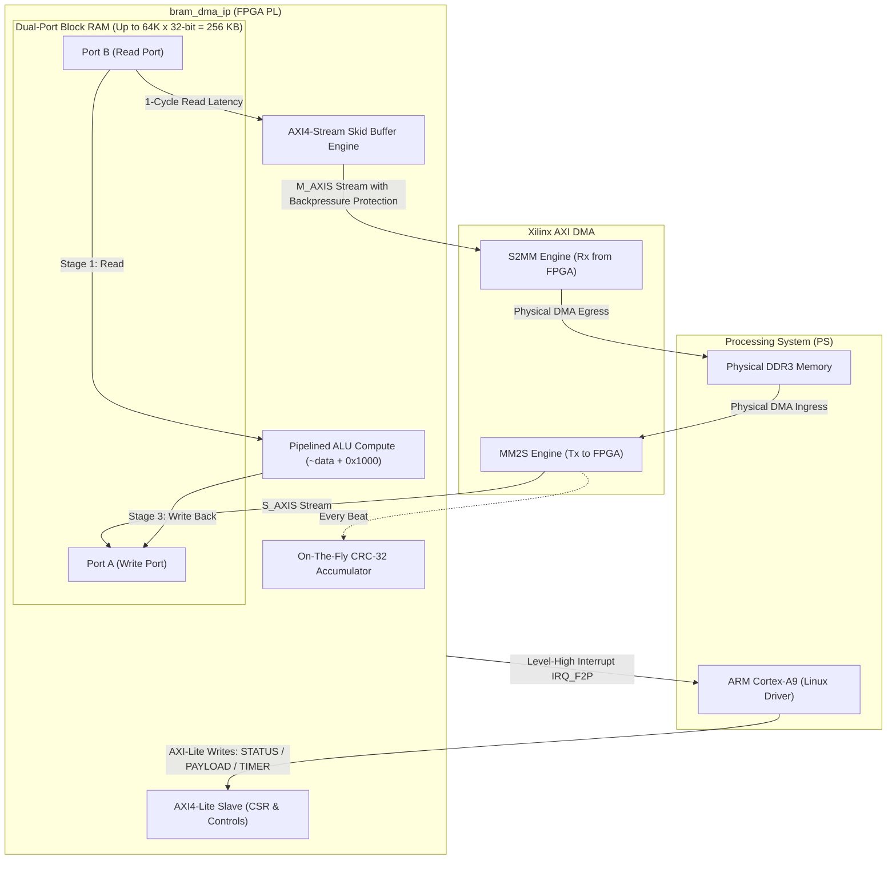
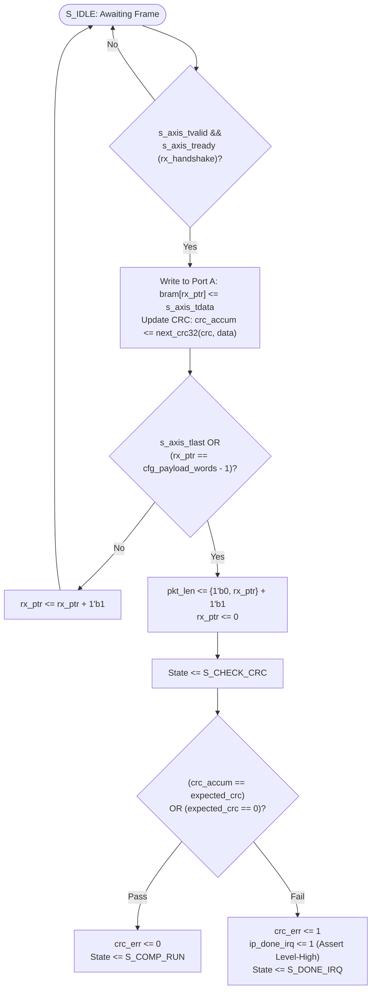
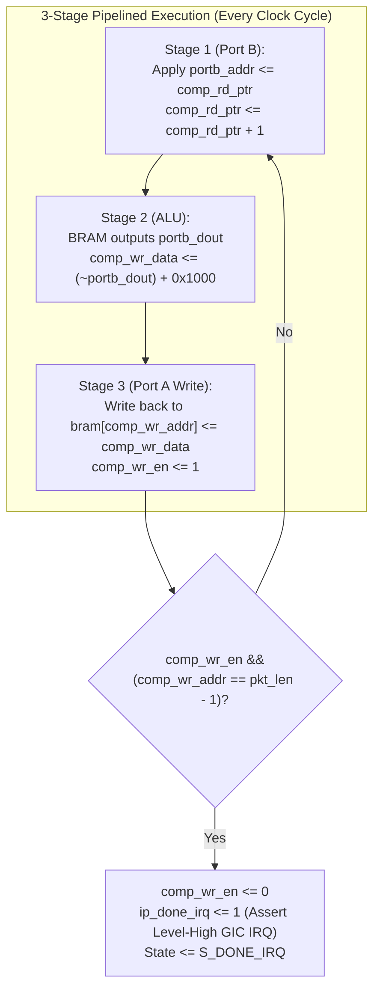
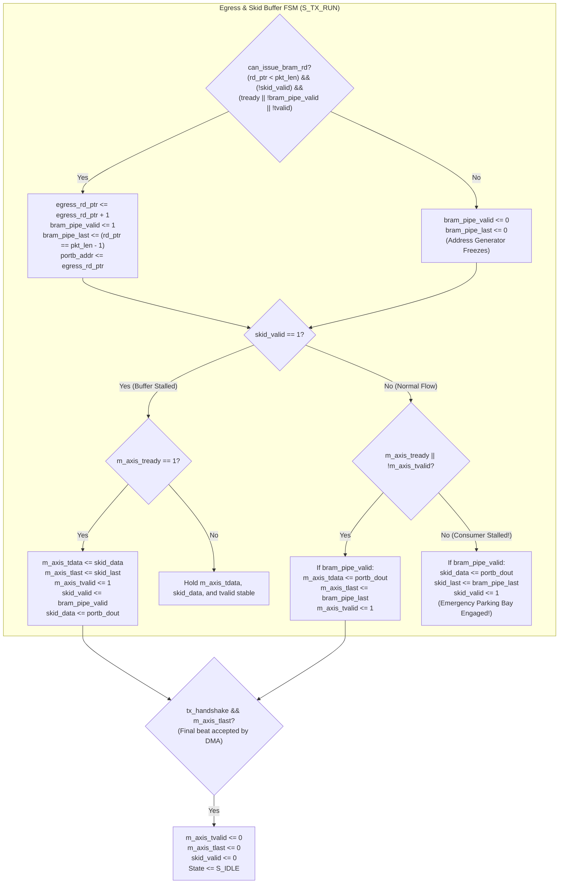

# Pipelined Store-and-Forward BRAM Accelerator IP: Architecture & Flow Specification

This document provides a detailed specification and architectural breakdown of the custom hardware accelerator IP ([`bram_dma_ip.v`](file:///Volumes/SWStorage/Projects/fpga-projects/pynq-z2-ps-pl-loopback/pynq-z2-fpga-ip/hdl/bram_dma_ip.v)) targeting the PYNQ-Z2 (Zynq-7000 SoC).

---

## 1. High-Level System Architecture

The accelerator is structured as a **Store-Compute-Forward** engine with full 100 MHz (400 MB/s line rate) pipelining on both compute and streaming egress:



---

## 2. Ingress (RX: DMA MM2S $\rightarrow$ BRAM) Workflow

The ingress path receives 32-bit streaming data from the DMA MM2S channel directly into BRAM Port A.



---

## 3. Pipelined Compute Workflow (`S_COMP_RUN`)

Compute runs in-place: **Port B** acts as the dedicated read port, and **Port A** acts as the dedicated write port. Once the 2-stage pipeline fills, **one word is read, transformed, and written back on every single clock cycle (100 MHz)**.



---

## 4. Egress (TX: BRAM $\rightarrow$ DMA S2MM) with Skid Buffering

The egress path streams processed words from BRAM Port B to `m_axis` at the maximum physical wire rate (1 beat per cycle = 400 MB/s). 

Because BRAM has a **1-clock-cycle read latency**, downstream backpressure (`m_axis_tready == 0`) requires a **Skid Buffer** to capture the in-flight read without dropping data.



---

## 5. Skid Buffer State & Timing Analysis (Handling Backpressure)

### Why is `reg [ADDR_WIDTH:0] comp_rd_ptr;` sized to `ADDR_WIDTH + 1` bits?
- BRAM contains $2^{\text{ADDR\_WIDTH}}$ words (e.g., $65,536$ words for $\text{ADDR\_WIDTH}=16$).
- The standard address space `[ADDR_WIDTH-1:0]` can only represent values from $0$ to $65,535$.
- When streaming or computing all $65,536$ words, the fetch pointer increments from $0 \rightarrow 65,535 \rightarrow \mathbf{65,536}$.
- If `comp_rd_ptr` were only $16$ bits, $65,535 + 1$ would **overflow back to 0**, causing the loop condition `comp_rd_ptr < pkt_len` ($0 < 65,536$) to become true again and loop infinitely.
- The 17th bit (`[ADDR_WIDTH]`) allows the counter to reach $65,536$ (`17'h10000`) cleanly without rollover.

---

### Why is `bram_pipe_valid` checked when `skid_valid == 1`?

Look at the skid draining logic in `S_TX_RUN`:
```verilog
if (skid_valid) begin
    if (m_axis_tready) begin
        m_axis_tdata  <= skid_data;
        m_axis_tlast  <= skid_last;
        m_axis_tvalid <= 1'b1;
        if (bram_pipe_valid) begin
            skid_data  <= portb_dout;
            skid_last  <= bram_pipe_last;
            skid_valid <= 1'b1;
        end else begin
            skid_valid <= 1'b0;
        end
    end
end
```

**Scenario: Stalling and Draining without Bubbles**
1. At cycle $T$, downstream deasserts `m_axis_tready = 0`. Word $A$ is held on `m_axis_tdata`.
2. A read was already in flight from cycle $T-1$. That word (Word $B$) emerges into `skid_data` at cycle $T+1$ (`skid_valid <= 1`).
3. Now suppose that on the exact cycle downstream reasserts `m_axis_tready = 1`, another read was finishing:
   - Word $B$ (from `skid_data`) moves to `m_axis_tdata` to satisfy the active handshake.
   - **If `bram_pipe_valid == 1`**: The newly emerging word from BRAM (`portb_dout`, Word $C$) immediately takes the empty parking spot in `skid_data` (`skid_valid <= 1`).
   - **If `bram_pipe_valid == 0`**: No new read was in flight, so the parking spot is now empty (`skid_valid <= 0`).

Checking `bram_pipe_valid` ensures the skid buffer is **re-armed if a read was in flight, or cleared if the pipeline was idle**, guaranteeing zero dropped words and zero bubble cycles.
