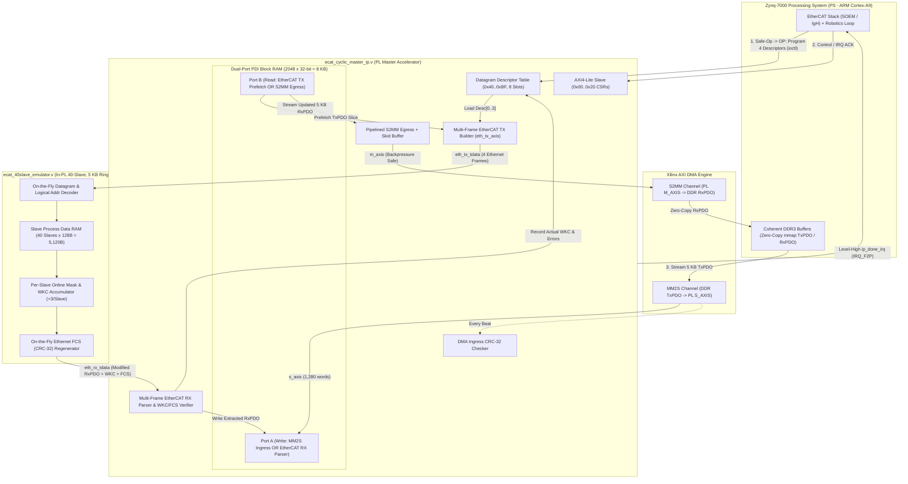
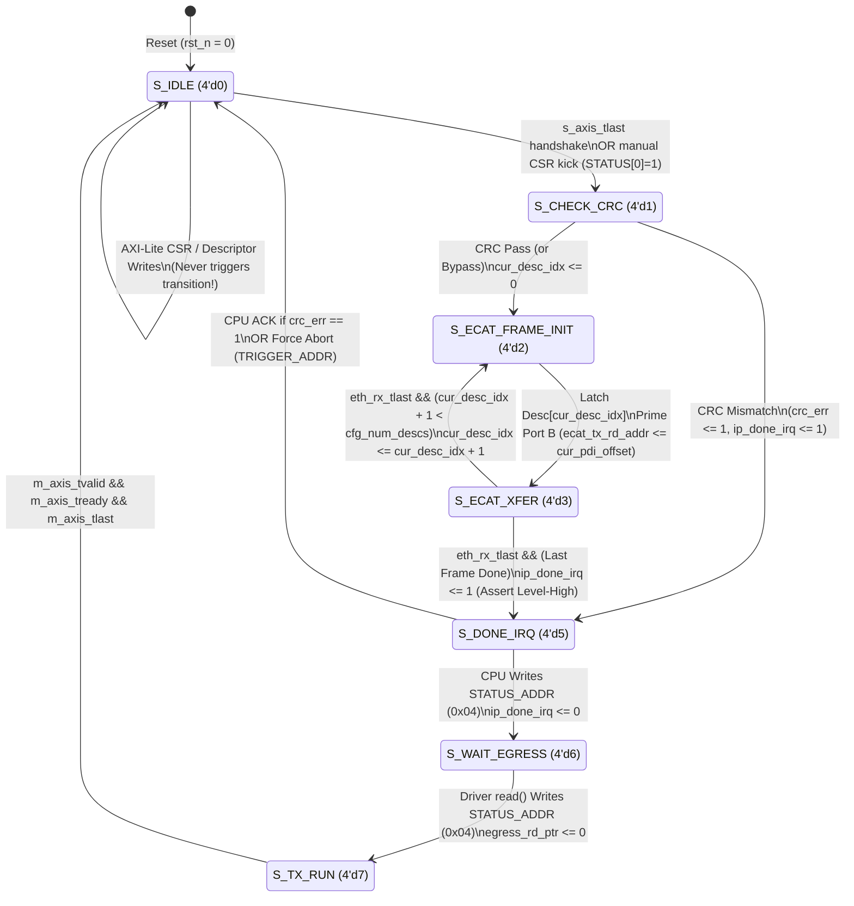
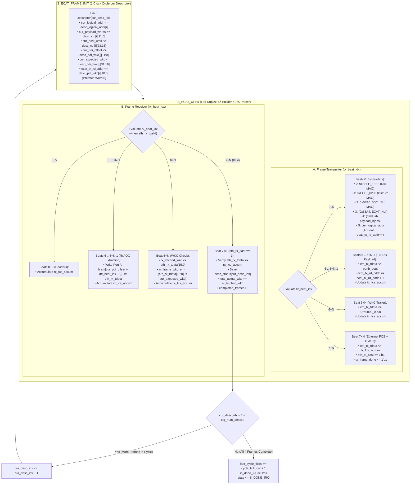
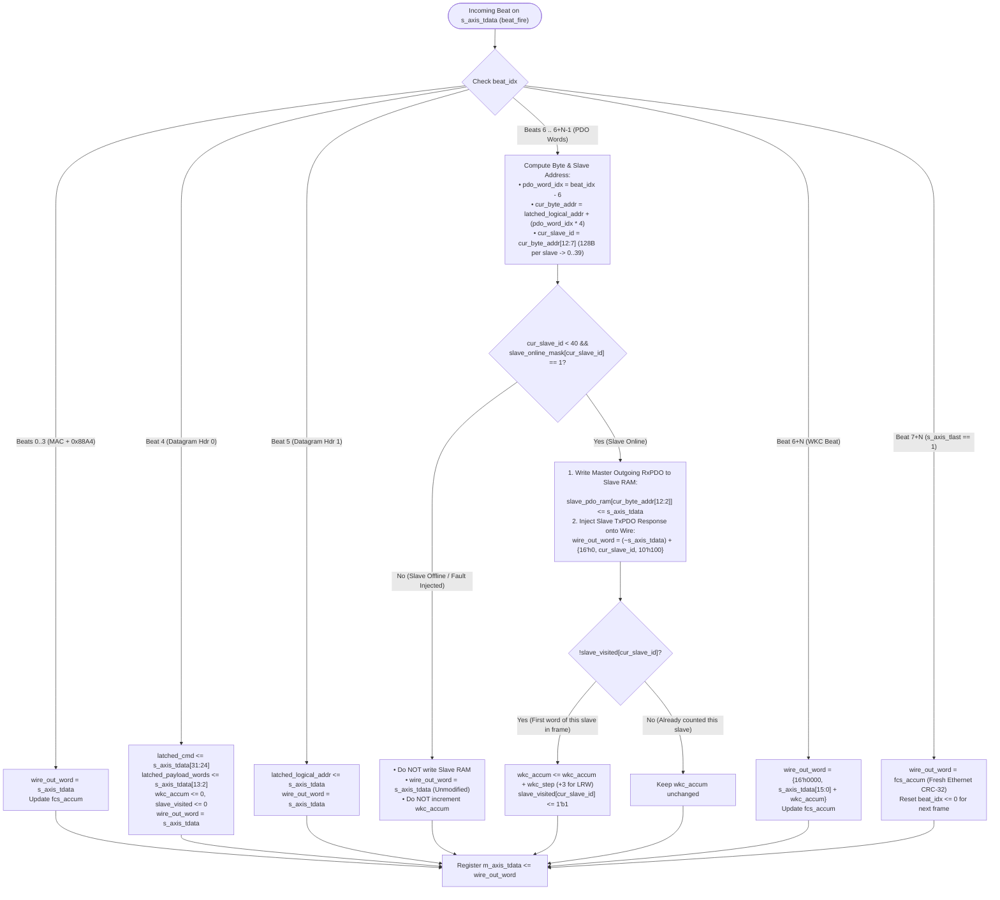
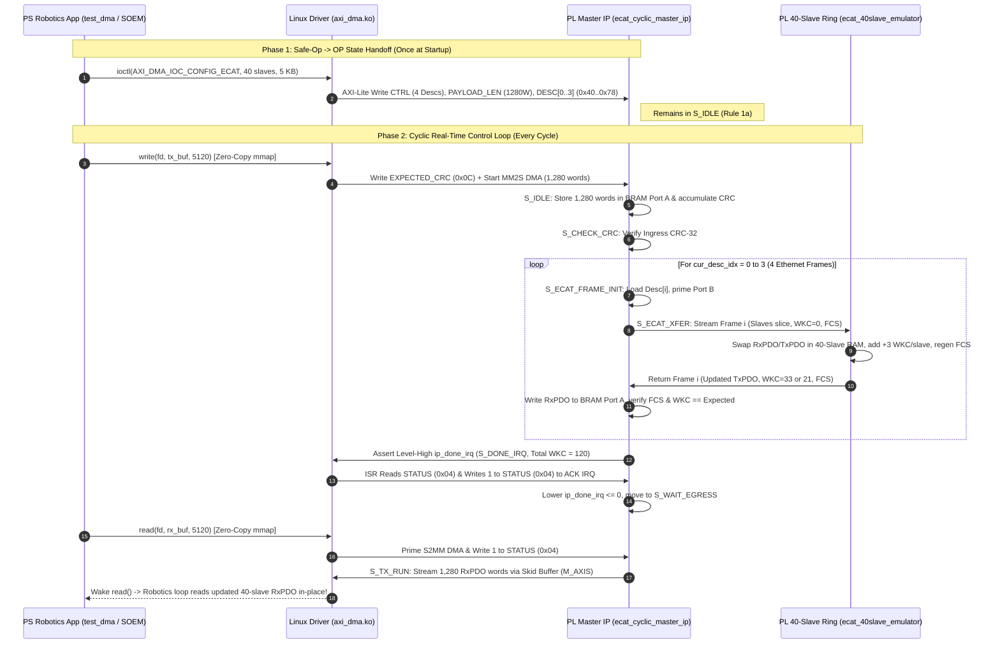

# Hybrid EtherCAT Cyclic Master & 40-Slave Ring Emulator: Detailed Hardware Flowcharts

This document provides a detailed, state-by-state and beat-by-beat architectural walkthrough of [`ecat_cyclic_master_ip.v`](/ecat_cyclic_master_ip.v) and [`ecat_40slave_emulator.v`](/ecat_40slave_emulator.v).

---

## 1. High-Level System & Datapath Architecture

---

## 2. Top-Level Master FSM Lifecycle (`ecat_cyclic_master_ip.v`)

The Master FSM (`state[3:0]`) coordinates three distinct phases in every robotics control cycle:
1. **DMA Ingress (`S_IDLE` $\rightarrow$ `S_CHECK_CRC`)**: Pulls the 5 KB `TxPDO` image from PS DDR into `bram` Port A.
2. **Multi-Frame EtherCAT Ring Exchange (`S_ECAT_FRAME_INIT` $\leftrightarrow$ `S_ECAT_XFER`)**: Iterates through `cur_desc_idx = 0 .. cfg_num_descs - 1` (4 frames for 5 KB), streaming each frame out through the 40-slave ring and parsing the returning `RxPDO`, `WKC`, and `FCS` back into `bram` Port A.
3. **Interrupt & DMA Egress (`S_DONE_IRQ` $\rightarrow$ `S_WAIT_EGRESS` $\rightarrow$ `S_TX_RUN`)**: Wakes the PS via Level-High IRQ and streams the updated 5 KB `RxPDO` image back to PS DDR via `m_axis`.

---

## 3. Detailed Multi-Frame EtherCAT TX & RX Engine (`S_ECAT_FRAME_INIT` & `S_ECAT_XFER`)

Inside `S_ECAT_XFER`, the Master operates **full-duplex**: the Frame Transmitter (`tx_beat_idx`) builds and injects an IEEE 802.3 + EtherCAT (`0x88A4`) frame into the slave ring while the Frame Receiver (`rx_beat_idx`) simultaneously strips returning `RxPDO` words and validates the Working Counter (`WKC`) and Ethernet FCS (`CRC-32`).

### Why `ecat_tx_rd_addr` Advances at `tx_beat_idx >= 5` (1-Cycle BRAM Prefetch)
* Synchronous Block RAM (`portb_dout <= bram[portb_addr]`) has a **1-clock-cycle read latency**.
* In `S_ECAT_FRAME_INIT`, `ecat_tx_rd_addr` is initialized to `cur_pdi_offset` (Word 0 of the frame's PDO slice).
* Therefore, during header beats `tx_beat_idx = 0..5`, `portb_dout` is already holding `bram[cur_pdi_offset + 0]`.
* On `tx_beat_idx == 5` (the beat right before `tx_beat_idx == 6` where PDO Word 0 is transmitted), `ecat_tx_rd_addr` increments to `cur_pdi_offset + 1` so that `portb_dout` will hold PDO Word 1 on `tx_beat_idx == 6`, staying 1 beat ahead across the entire payload!

---

## 4. 40-Slave, 5 KB Ring Emulator Flowchart (`ecat_40slave_emulator.v`)

The emulator processes the Master's AXI-Stream frame **on the fly (1 beat per clock cycle)** without store-and-forward buffering, mirroring how physical Beckhoff ESC ASICs process frames in a daisy-chain ring:

---

## 5. End-to-End Sequence Diagram (PS Driver $\leftrightarrow$ PL Master $\leftrightarrow$ 40-Slave Ring)

